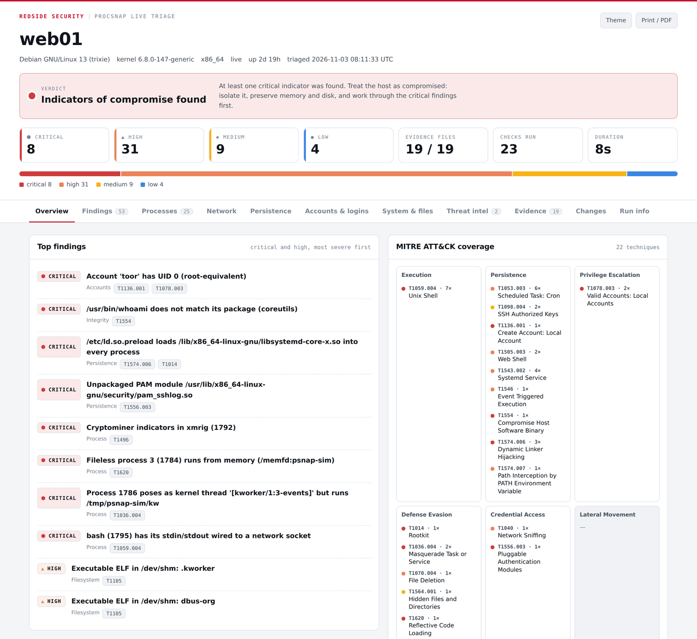
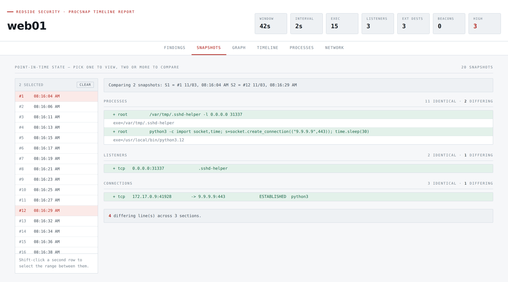
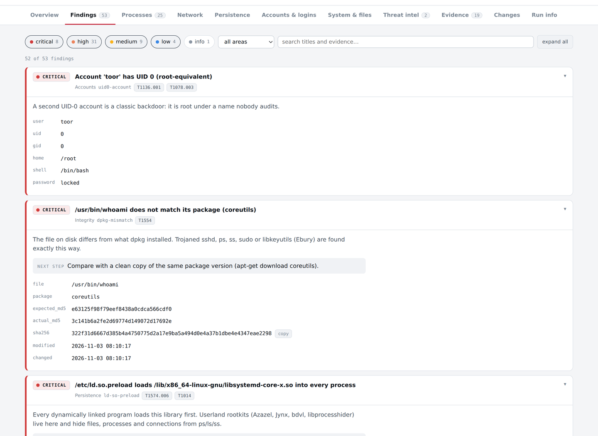
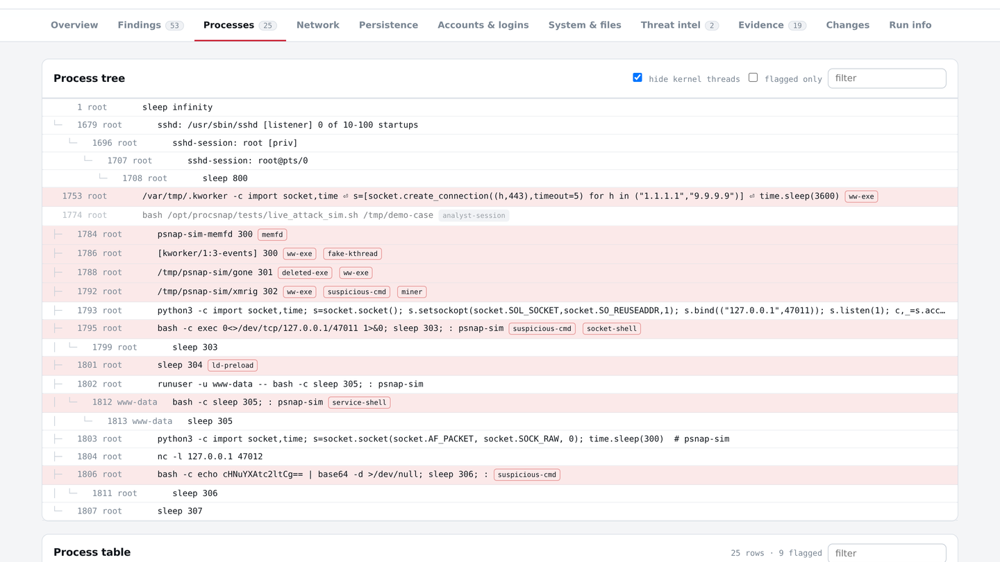
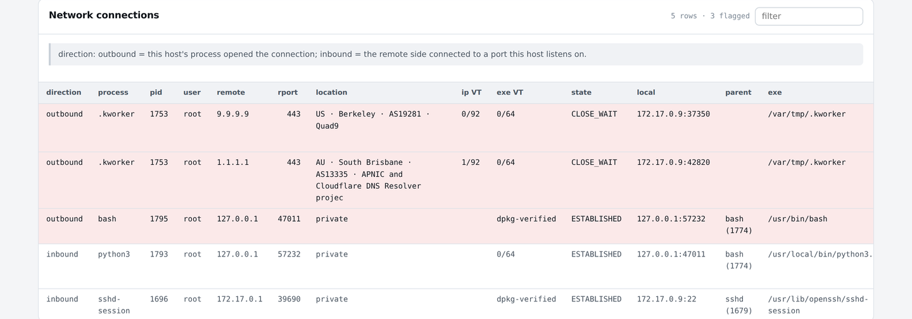
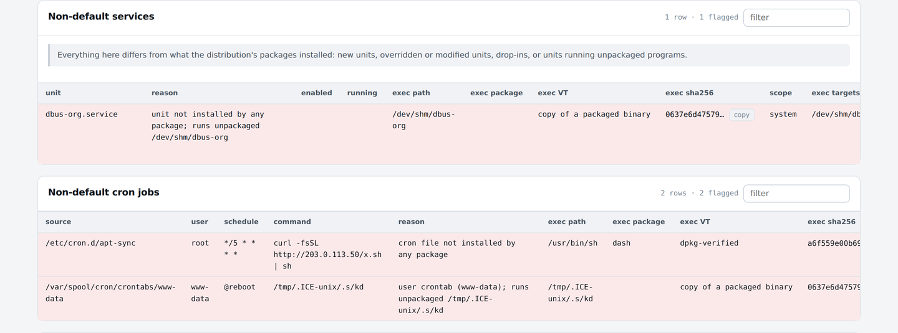
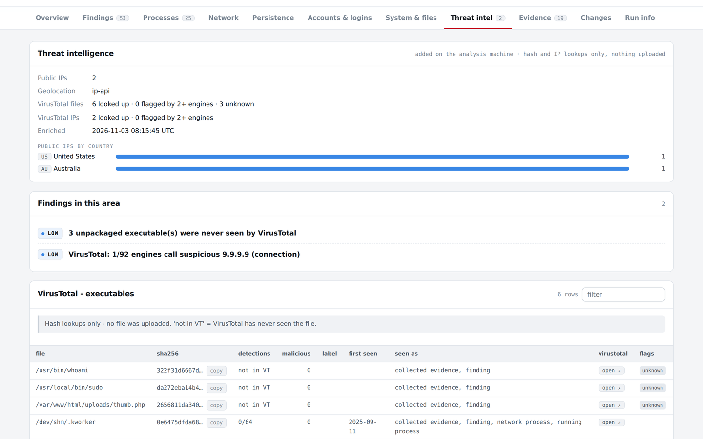

# ProcSnap

**Live incident-response triage for Linux servers (Debian and Ubuntu).**
Copy one Python file to a suspect host, run it, and within about a minute you know
whether the host is compromised, how the attacker got in, and how they are staying.
Every finding comes with its MITRE ATT&CK technique and the evidence behind it. The
suspicious files are hashed and collected, and the result is a self-contained report
you can attach to the case.



<sub>All screenshots come from `web01`, a synthetic demo host built in a throwaway container
(`docs/demo/plant_demo_host.sh` + `tests/live_attack_sim.sh`). No real system data.</sub>

## Why this exists

Live analysis of an infected Linux machine is one of the hardest jobs in incident
response. Most servers have no EDR, so when an alert fires the responder SSHes in and
starts typing `ps`, `ss`, `crontab -l`, `last` and works through a mental checklist under
time pressure, while:

- **The host may be lying.** A userland rootkit in `/etc/ld.so.preload` hides
  processes and files from `ps` and `ls`; a trojaned `ss` or `sshd` reports what the
  attacker wants.
- **The evidence is scattered** across `/proc`, `/etc`, the package database, PAM,
  cron, systemd, SSH keys, `wtmp`, shell history and the kernel's module list. Every
  responder checks a slightly different subset, and the subset depends on how tired
  they are.
- **Every command contaminates the scene.** Your own commands show up in the process
  list and history, and binaries that delete themselves vanish the moment you kill
  the wrong PID.
- **Nothing is written down.** Ten minutes later it is hard to prove what was running,
  and impossible to compare against yesterday or against a clean server of the same
  role.

ProcSnap turns that checklist into a tool. It reads the sources directly (`/proc`,
dpkg's own checksums, raw `utmp` records, unit files) instead of trusting the host's
utilities. It runs the same ~130 checks every time, ignores your own session, copies
volatile evidence out before it disappears, and writes it all down as JSON + HTML
with hashes.

## How it works

```
 SUSPECT HOST  (no internet needed, nothing installed)        ANALYSIS MACHINE  (internet)
 ───────────────────────────────────────────────────          ───────────────────────────────────────
 collect_case.sh                                              procsnap_analyze.py case.tar.gz
  ├─ procsnap.py triage   one-shot assessment:                 ├─ safe unpack (archive is untrusted)
  │    processes · network · sessions · persistence            ├─ geolocation + ASN of public IPs
  │    accounts · logins · kernel · package integrity          ├─ VirusTotal: executable hashes + IPs
  │    filesystem · SHA-256 of every executable                │   (lookups only - nothing uploaded)
  ├─ procsnap.py collect  optional watch period:               ├─ optional baseline-DB comparison
  │    process / connection / listener changes                 └─ triage.html · timeline.html
  └─ case.tar.gz + .sha256 ────────── scp ──────────▶             intel.json · triage.enriched.json
```

`procsnap.py` is one file, Python 3.8+ standard library only. It is already on every
Debian/Ubuntu server, so there is nothing to install on the target.

## Commands

### 1. Live triage on the target

```bash
# copy two files to the suspect host and collect a case
scp procsnap.py scripts/collect_case.sh root@web01:/root/
ssh root@web01 '/root/collect_case.sh'                    # triage only, ~1 minute
ssh root@web01 '/root/collect_case.sh -w 30m -i 5s'       # triage, then watch 30 min every 5 s
scp 'root@web01:/var/tmp/procsnap-web01-*.tar.gz*' .
```

`collect_case.sh` options: `-o DIR` (where to write; use removable media to avoid
touching the suspect disk), `-w DURATION` (collector watch period, e.g. `30m`),
`-i INTERVAL` (snapshot interval, default `5s`), `-d DAYS` ("recently changed" window,
default 7), `--deep` (verify every packaged file, scan every PID, sweep all of `/`),
`--keep-dir`.

Or run the triage directly without the wrapper:

```bash
sudo ./procsnap.py triage                          # -> ./triage-<host>-<time>/  (json, html, evidence/, HASHES.txt)
sudo ./procsnap.py triage -o /mnt/usb/case-42      # write the case off the suspect disk
sudo ./procsnap.py triage --deep --days 30         # slower, wider
sudo ./procsnap.py triage --baseline web-role.json # also compare with your known-good DB (see below)
sudo ./procsnap.py triage -o '' > triage.json      # write nothing locally; JSON on stdout
./procsnap.py triage --root /mnt/image -o case     # dead-box triage of a mounted disk image
```

### 2. Analysis on your workstation

```bash
sha256sum -c procsnap-web01-*.tar.gz.sha256
./procsnap_analyze.py procsnap-web01-*.tar.gz                          # geolocation only
./procsnap_analyze.py procsnap-web01-*.tar.gz --vt-key "$VT_API_KEY"   # + VirusTotal
./procsnap_analyze.py case.tar.gz --geo ipinfo --ipinfo-token "$TOK"   # commercial-use geo source
./procsnap_analyze.py case.tar.gz --baseline web-role.json             # + baseline comparison
./procsnap_analyze.py case.tar.gz --offline                            # no lookups at all
```

Output, in `<case>-analysis/`: `triage.html` (the report), `timeline.html` (when the case
has a watch period), `triage.enriched.json`, `intel.json`.

| Option | Meaning |
|---|---|
| `--vt-key KEY` / `$VT_API_KEY` | VirusTotal lookups for executable SHA-256s and public IPs. **Hash/IP lookups only, nothing is ever uploaded.** The key is never written anywhere |
| `--vt-rate N`, `--vt-max N` | pace (default 4/min, the free tier) and cap (default 480/run). Unpackaged binaries, ones owning external connections and non-default services/cron go first; answers are cached in `~/.cache/procsnap` |
| `--vt-all` | also look up package-owned binaries (dpkg already verifies them) |
| `--geo ip-api` / `ipinfo` / `none` | geolocation source. ip-api.com is free with no key but **non-commercial**; use ipinfo (free token) for client work |
| `--compare old.json` | adds a Changes tab: new and resolved findings and every inventory change |

### 3. Continuous collection and snapshots

```bash
sudo ./procsnap.py collect -i 10s -o /var/log/procsnap --gzip       # until Ctrl+C / kill
sudo ./procsnap.py collect -i 5s --count 360 -o ./watch             # 30 minutes, then stop
sudo ./procsnap.py install-service -i 10s --retain-days 30          # as a systemd service
sudo ./procsnap.py once -o ./watch                                  # a single snapshot

./procsnap.py snapshots ./watch                     # list snapshot points (#1, #2, ...)
./procsnap.py show      ./watch --at '#12'          # full host state at snapshot 12
./procsnap.py diff      ./watch --at '#1' --at '#12' -v          # what changed between two moments
./procsnap.py diff      ./watch --at 03:10 --at 03:20 --at last  # N-way presence matrix
./procsnap.py report    ./watch --since 2h          # summary + heuristic flags
./procsnap.py timeline  ./watch --grep curl         # chronological events
./procsnap.py conns     ./watch --external-only -v  # who talked to what
./procsnap.py sqlite    ./watch -o case.db          # ad-hoc SQL
./procsnap_viz.py       ./watch -o timeline.html    # interactive report; open timeline.html#snaps=1,12
```

`--at` accepts `#N`, `first`, `last`, a clock time (`03:14:00`) or an epoch.

### 4. Baseline DB of known-good hosts

```bash
./procsnap.py mkbaseline clean-web1/triage.json clean-web2/triage.json -o web-role.json
./procsnap.py triage --baseline web-role.json             # or procsnap_analyze.py ... --baseline
./procsnap.py triage-diff before/triage.json after/triage.json
```

## How the snapshot chain works

The collector does not dump the whole process table every interval, which would be
huge and impossible to query. It records **changes**:

1. **Snapshot 1** reads `/proc` and writes every process, listener and connection once
   (`proc_start` / `listen_open` / `conn_open` with `baseline: true`).
2. **Every later snapshot** compares with the previous one and writes only the
   differences: `proc_start`, `proc_exit` (with lifetime and peak memory),
   `exe_deleted` (binary removed while running), `conn_open` / `conn_close` (with
   direction and duration), `listen_open` / `listen_close`. Each snapshot also writes
   one `heartbeat`, which is the snapshot marker (`#1`, `#2`...).
3. Every `--full-every` snapshots (hourly with the service) a full `inventory` line is
   written as a resync point. A new `collector_start` (restart, reboot, cron'd `once`)
   starts a fresh chain.
4. To answer "what did the host look like at snapshot #12?", `show`, `diff` and the
   report's Snapshots tab **replay the chain** from the last `collector_start` up to
   that heartbeat and rebuild the exact state. `diff` does that for two or more
   moments and prints what appeared (+), disappeared (−), or an N-way presence matrix.



It is a poller: something that starts and exits between two snapshots is not seen.
Pair it with `auditd` (`-a always,exit -F arch=b64 -S execve`) when you need every exec.

## What the triage checks

About 130 finding types, each documented with severity, ATT&CK technique and the usual
benign explanation in [docs/TRIAGE_CHECKS.md](docs/TRIAGE_CHECKS.md).

| Area | Highlights |
|---|---|
| Processes | fileless (memfd) binaries, fake kernel threads, deleted executables, reverse shells (a shell with a TCP socket for stdin), web-server-spawned shells, `LD_PRELOAD` injection, miners, ptrace, **hidden PIDs** brute-forced against `/proc`, SHA-256 of every executable |
| Network | every connection with **direction** (outbound / inbound), process, PID, user, executable, command line, parent, package and hash; listeners; bind shells; C2 candidates; **raw/packet sockets** (sniffers, BPFDoor-style backdoors); promiscuous NICs |
| Sessions | **who is logged in now**, with session length, idle time and what they run, cross-checked from utmp, systemd-logind and sshd processes (catches scp/sftp/`ssh host cmd` sessions and sessions hidden from `who`); every past session's duration |
| Logins | **successful login from a source that was brute-forcing**, service-account logins, account creation and privileged-group changes |
| Services & cron | **default vs non-default** against the distribution's packages (unit installed by a package, unmodified per dpkg MD5, no unpackaged drop-in, programs package-owned). The real program behind every unit and cron job is resolved with path, package and hash |
| Persistence | cron, at, anacron, incron, systemd units/timers/generators/user units/transient units/lingering, rc.local, init.d, MOTD, **APT and dpkg hooks**, udev, network hooks, XDG autostart, logrotate scripts, shell start-up files, `/etc/skel` |
| Hijacking | `ld.so.preload`, `LD_PRELOAD` in systemd/environment/sudo, **unpackaged PAM / NSS modules and sudo plugins**, polkit rules, **Apache/nginx modules**, PHP `auto_prepend_file`, unpackaged libraries in system lib dirs, **`/usr/local/bin` shadowing system commands**, Python startup hooks, git fsmonitor/pager |
| SSH | authorized keys (fingerprinted, `environment=`/`command=`), `~/.ssh/rc`, sshrc, **user CA keys**, principals, `ForceCommand`, risky sshd settings |
| Accounts | extra UID-0 users, empty passwords, password hashes in `/etc/passwd`, service accounts with shells, root-equivalent groups, sudo rules |
| Kernel & boot | **hidden kernel modules**, rootkit names, modules with no file, taint flags, **kernel `init=`**, initramfs hooks |
| Integrity | **every system binary, PAM module and core library checked against dpkg's MD5s** (trojaned `sshd`, `ps`, `sudo`, Ebury's `libkeyutils`), modified security config files |
| Filesystem | unpackaged SUID/SGID files and capabilities, executables in `/tmp` and `/dev/shm`, hidden `...` directories, web shells, **`chattr +i`-locked persistence**, recent-change timeline |
| Containers | Docker containers that **auto-restart with host access** (privileged, `/` or `docker.sock` mounted), Kubernetes static pods |

## The report

A single HTML file: no CDN, no fonts fetched, no server. It has light and dark themes
and prints to PDF. Everything taken from the host is attacker-controlled, so it is
embedded as escaped JSON and inserted with `textContent` only; a malicious process name
cannot script the analyst's browser.

**Findings:** each card says why it matters, what to do next, and shows the evidence.



**Processes:** the tree with flags, so you can see what spawned what.



**Network:** direction, process, user, location, IP and executable VirusTotal scores
in one row.



**Persistence:** non-default services and cron jobs, the programs they really run,
and their hashes.



**Threat intel:** what the analysis machine added.



## Testing

```bash
python3 -m unittest discover -s tests -v   # 37 tests: a compromised Debian rootfs with 63 planted
                                           # techniques + the analyser against a mock VirusTotal/ip-api
sudo tests/live_attack_sim.sh              # 14 harmless live attack simulations on this host, then cleanup
sudo tests/collector_selftest.sh           # collector: flags, beacon detection, deleted binaries
```

The offline suite also asserts that clean controls stay quiet (genuine `sshd`, stock
`pam_permit`, `alias ls`, a setuptools `.pth` hook), so false positives are tested too.
The live simulation starts real but harmless processes in separate sessions: a memfd
binary, a fake `[kworker]`, a reverse shell to 127.0.0.1, a fake `xmrig`, `LD_PRELOAD`,
a packet socket, a netcat listener, a www-data shell and more. It verifies each
detection, then kills and removes everything.

## Operational security

- **Nothing on the target touches the network.** All lookups happen on the analysis
  machine, and only public IPs and file hashes are sent.
- **VirusTotal is lookups only.** Uploading a targeted sample makes it public and can
  warn the attacker.
- **Collected samples are stored read-only** (`*.sample`, mode 0400, never
  executable), and the analyser treats the case archive as hostile (no path
  traversal, no links).
- Record the hash of `procsnap.py` in your case notes; every `triage.json` embeds it.

## Limits

- **It reads through the running kernel.** A kernel rootkit can lie to `/proc`. The
  hidden-PID, hidden-module and package-checksum checks catch the common ones, not the
  good ones. For certainty, capture memory (AVML + Volatility) and image the disk.
- **Unpackaged doesn't mean malicious.** Vendor agents, `/usr/local` software and
  containers are normal; findings explain why each item matters and the analyst decides.
- **Local logs are attacker-writable.** On a root-compromised host, prefer off-host copies.
- **Debian family.** Package ownership and integrity come from dpkg; on other
  distributions those checks switch off (and say so) and everything else still runs.

## Roadmap

- **IoC export to STIX 2.1 / CSV and OpenCTI.** Export hashes, IPs and VirusTotal
  verdicts from a case as a STIX bundle and CSV, and push them to OpenCTI the same way
  [AnyStix](https://github.com/RedSideSecurity/AnyStix) does.
- **YARA.** Scan collected samples on the analysis machine, and optionally process
  memory on the target when a `yara` binary is available there.
- **journald support** for hosts without `/var/log/auth.log` (Debian 12+), and
  **wtmpdb / lastlog2** (Debian 13) for login history.
- Optional memory capture (AVML), fleet-wide reports, RPM-based distributions,
  auditd/eBPF exec capture.

## Documentation

- [docs/TRIAGE_CHECKS.md](docs/TRIAGE_CHECKS.md): every check, severity, ATT&CK mapping, benign explanations
- [docs/IR_PLAYBOOK.md](docs/IR_PLAYBOOK.md): how an IR team uses ProcSnap from preparation to reporting
- [docs/FORMAT.md](docs/FORMAT.md): `triage.json`, baseline DB and collector JSONL formats
- [CHANGELOG.md](CHANGELOG.md), [SECURITY.md](SECURITY.md)

## License

MIT © RedSide Security
